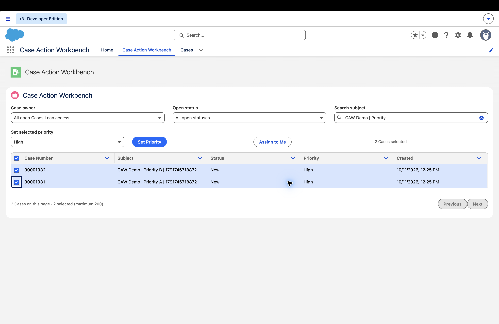
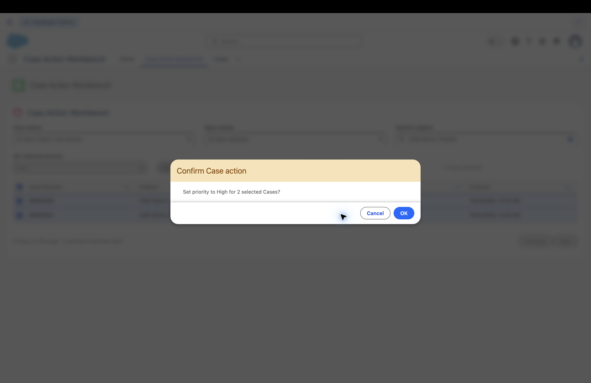
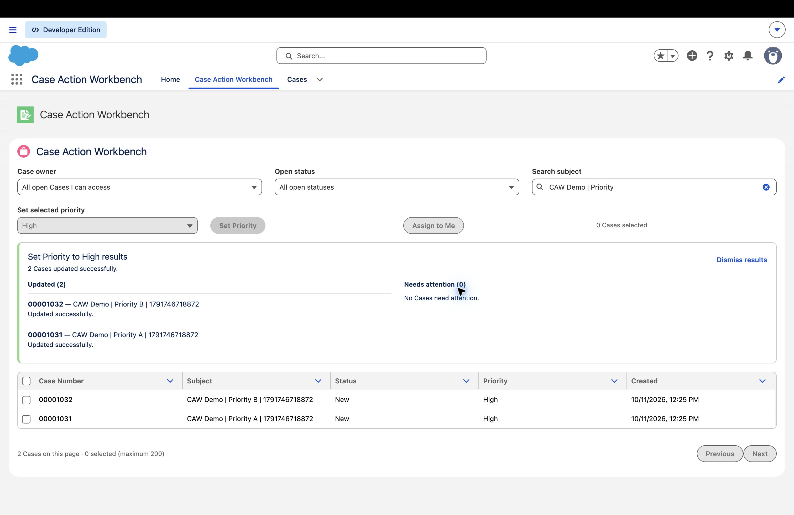
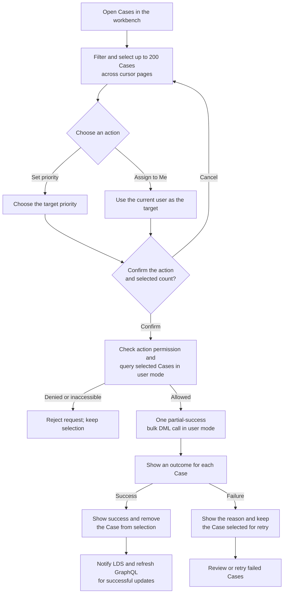
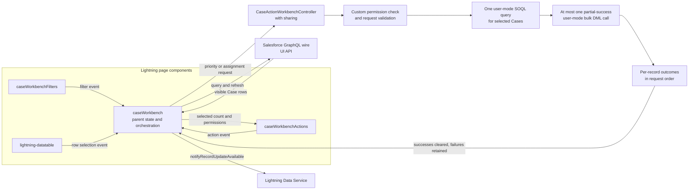

# 🧰 Case Action Workbench

**Select with care. Update in bulk. See every result.**

A permission-aware Salesforce Case bulk-action workbench. Users select records in its own paginated table, confirm the requested change, and get a result for each Case.

> This is a dedicated Lightning App Page with its own selection. It is **not** a native LWC list-view or related-list action.

## See it in action

These real screenshots were captured in the connected Dev Hub Developer Edition org on October 11, 2026, using the repeatable `CAW Demo` records from the [demo guide](demo/README.md).



<details>
<summary>Review the confirmation step</summary>

The workbench names the requested change and shows how many Cases will be affected before it calls Apex.



</details>

<details>
<summary>Review per-record results</summary>

The results panel reports each Case separately and reserves a second section for records that need attention.



</details>

## Why I built it

Salesforce admins have asked for a native list or related-list button that can launch an LWC and pass the selected record IDs into it. The [IdeaExchange request](https://ideas.salesforce.com/s/idea/a0B8W00000QO2m8UAD/add-lwc-as-custom-button-for-related-list-and-list-view) describes that workflow; Salesforce's response says the enhancement is not on the product roadmap. The comments also make clear that a button which only navigates to an app page misses the key requirement: carrying the user's selected records into the component.

This project explores a supported, honest workaround for a concrete Case workflow. The workbench owns record selection inside a Lightning page, then applies permission-checked bulk actions. It does not claim to implement the native list-view feature requested in the IdeaExchange.

## What it does

- Browse open Cases the current user can access, or narrow the view to Cases they own.
- Filter by status and search Case subjects.
- Select up to 200 Cases across cursor-paginated pages.
- Set selected Cases to High priority or assign them to the current user.
- Confirm the action and selected count before any update runs.
- Show successful and failed Cases separately, including each Case number, subject, and failure message. Failed Cases stay selected for retry.
- Re-query through the GraphQL wire adapter and notify Lightning Data Service after successful updates.

For a guided walkthrough and repeatable demo records, see [the demo guide](demo/README.md).

## How it is put together

### Action workflow



### Component and data flow

The parent owns filters, cursor pagination, selection across pages, confirmation, and results. Child components expose user intent through custom events. Salesforce base components provide the table, filters, action controls, and confirmation dialog.



Each action is capped at 200 selected Cases. Apex returns outcomes in request order, so the UI can show a Case number, subject, and result for every selected record.

## Security and product boundaries

`CaseActionWorkbenchController` runs `with sharing`. It checks `Can_Bulk_Set_Case_Priority` or `Can_Assign_Cases_To_Self` on every request, re-queries Cases in user mode, validates the priority, enforces the 200-record limit, and performs partial-success DML in user mode. Each request uses one user-mode query and at most one bulk DML call, with no per-record SOQL or DML. The controller preserves request order in its per-record results. The UI hides actions when the user lacks the custom permission, but the Apex check is the authorization boundary.

Assign the `Case_Workbench_User` permission set to each intended user. Their profile, Case object and field permissions, and sharing access still govern the records they can view and update.

This app does not add an LWC to standard list-view buttons or related-list buttons, and does not accept selected IDs from those surfaces. Its selection exists only in the workbench table. The initial status options are New, Working, and Escalated; adapt them if an org uses a different Case status configuration.

The workbench owns no Case trigger; updates still run through the org's normal Case automation. The [Trigger Actions Framework](https://github.com/mitchspano/trigger-actions-framework) coordinates the order, partitioning, and bypass behavior of record-triggered Apex and Flow actions. It complements this UI-facing controller if an org needs that automation coordination; it does not replace the workbench's request authorization or selection flow.

## Try it in a Salesforce org

Requirements: Salesforce CLI, Node.js, and a Salesforce Developer Edition or sandbox org.

```bash
sf org login web --alias YOUR_ORG_ALIAS --instance-url https://login.salesforce.com
sf project deploy start --target-org YOUR_ORG_ALIAS
sf org assign permset --name Case_Workbench_User --target-org YOUR_ORG_ALIAS
```

Open **Case Action Workbench** from the App Launcher, then choose the **Case Action Workbench** tab. For a repeatable walk-through, run the [demo seed script](demo/README.md) and follow its steps.

## Development checks

```bash
npm ci
npm test
npm run lint
npm run prettier:verify
sf apex run test --target-org YOUR_ORG_ALIAS --class-names CaseActionWorkbenchControllerTest --wait 30 --code-coverage
```

Deploy changes with `sf project deploy start --target-org YOUR_ORG_ALIAS` after local checks.

## Verification

Verified October 11, 2026: all 8 LWC Jest tests passed across 3 suites, ESLint and Prettier passed, and all 4 Apex controller tests passed with 88% controller coverage. In the Developer Edition org, the browser flow confirmed a two-Case priority update and a one-Case assignment, including the confirmation step and per-record result panels. A SOQL readback showed both priority Cases at High and the assignment Case owned by the signed-in user. See the [demo guide](demo/README.md) for setup, steps, and the verification record.

## References

- [Original IdeaExchange request](https://ideas.salesforce.com/s/idea/a0B8W00000QO2m8UAD/add-lwc-as-custom-button-for-related-list-and-list-view)
- [Salesforce button considerations](https://help.salesforce.com/s/articleView?id=platform.links_considerations.htm&language=en_US&type=5)
- [Salesforce LWC data guidelines](https://developer.salesforce.com/docs/platform/lwc/guide/data-guidelines.html)
- [GraphQL wire adapter](https://developer.salesforce.com/docs/platform/graphql/guide/graphql-wire-lwc-use.html)
- [GraphQL pagination and refresh](https://developer.salesforce.com/docs/platform/graphql/guide/graphql-wire-lwc-paginate.html)
- [Secure Apex classes](https://developer.salesforce.com/docs/platform/lwc/guide/apex-security)
- [Apex Hours: Lightning Web Components best practices, Part 2](https://www.apexhours.com/lightning-web-components-lwc-part-2/)
